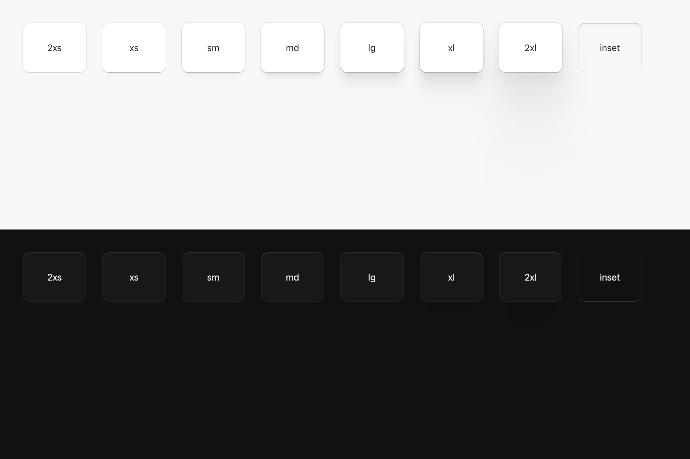

# UI shadows

Frame uses one elevation scale in light and dark mode, plus a shared inset
variant for recessed controls and the infinite canvas. Every imported level includes its
own 1 px outer edge, a subtle 1 px inset edge, and a top highlight. Do not add a
decorative border or another highlight to a surface using this scale.



## Choosing a level

| CSS level | Native role | Apply to |
| --- | --- | --- |
| `2xs` | `INDICATOR` | Swatches, color picker fields and handles, resize handles, scrollbar thumbs. |
| `xs` | `CONTROL` | Select triggers, filled buttons, selected toolbar buttons and tabs, track selectors, value badges, subtitle file controls. |
| `sm` | `EMBEDDED_PANEL` | Release notes, inline error panel. |
| `md` | `CARD` | Main file list, preview, settings, logs, and welcome cards through `FrameSurface::card_surface`. |
| `lg` | `FLOATING` | Select menus, color picker popovers, tooltips, floating preview/crop/overlay toolbars, log scroll button, active file drop target, Linux client window frame. |
| `xl` | `MODAL` | App settings sheet, update dialog, import overlay panel. |
| inset `xs` | `recessed_control()` | Text/number/timecode/hex inputs, slider, timeline and progress tracks, checkboxes, selection dots, Workspace/Logs navigation container, infinite canvas. All use the input background (`palette.canvas`). |
| `2xl` | `ShadowLevel::Xxl` | Available for a future high floating surface with room for the 211 px offset. Currently unused: ordinary dialogs use `xl`. |

Use the role at the call site, for example:

```rust
.shadow(theme::shadows::CONTROL.shadows())
```

Choose the level by the surface's role, not by its background color. The shadow
API deliberately takes no palette, theme, or platform argument. The [Geist color hierarchy](../colors/README.md) is separate from these effects.
Main cards retain their opaque fill. Surface colors use exact Geist values without
additional dark-mode dimming.

The inset variant derives from all eight `xs` layers. Dark outer layers become
inset with their original downward offsets, making the upper inner shadow. The
white inset layers reverse their vertical offsets, putting the highlight at the
bottom. Colors, blur and spread remain those of `xs`; there is no external shadow.
Checked and unchecked checkbox backgrounds both match the input; the check/dash
marks communicate their state.

Sliders, the trim timeline, and update download progress share `frame_range_track`:
a 10 px high pill with a 5 px radius, a 2 px inset on every side, and a 6 px high
fill with a 3 px radius. The fill uses `text_primary` in both themes. An empty
value draws no fill; 100% still preserves the inset. These dimensions scale with
the UI. Pointer values, handles, and the playhead use the inner range; the slider's
24 px hit area and the timeline's 30 px hit area remain unchanged. The download
bar uses this same component in both the update dialog and app settings.
The enclosing preview card keeps its `md` elevation around the recessed canvas.

The canvas paints its inset finish in a dedicated foreground element, after the
media/crop content and rounded-corner cutouts, but before floating controls.
Putting that shadow on the parent `Div` would draw it before the media, allowing
zoomed or panned images to cover the highlight at the viewport edge. The foreground
has no hitbox and does not intercept pan, zoom, crop or toolbar interactions.
Its bounds and radius follow the viewport, independently of the media transform.

## Rendering and sizing

- Colors are the supplied eight-digit `#RRGGBBAA` values. The near-black
  `#030302` and every alpha byte are preserved.
- CSS paints the first listed shadow on top. GPUI paints in list order, so the
  adapter reverses the list. GPUI draws outer shadows before the fill and inset
  shadows after it. The shared GPUI shader clips outer shadows out of the rounded
  element interior, so translucent controls keep their fill color.
- GPUI's shader uses Gaussian standard deviation. The adapter passes half the
  source CSS blur radius, matching the [CSS shadow blur definition](https://www.w3.org/TR/css-backgrounds-3/#shadow-blur).
  Source tokens and CSS retain the original blur values.
- Offsets, blur, spread, and edges use logical pixels. A 1 px edge has the same
  logical width on macOS, Linux, and Windows; Retina maps it to device pixels.
  It does not become a half-pixel line on macOS or grow with the UI font scale.
- The `-0.5px` spread in `xs` and `sm` is intentional source geometry, not a
  half-pixel border. It remains unchanged.
- Do not wrap a floating surface in a clipping container that cuts off its
  shadow. Scrolling content may clip inside the surface. Native window bounds
  still clip client-drawn shadows; macOS and Windows keep system window shadows.

## Component audit

The audit covers the shared builders and each surface drawn directly by a view.
Settings pages inherit the scale through their shared inputs, buttons, selectors,
sliders, track rows, and parent card.

| Area / source | Surface coverage and intentional flat elements |
| --- | --- |
| `components/button.rs`, `primitives.rs` | Filled actions use `xs`. Ghost icon/text buttons stay flat until a selected variant has a surface. |
| `input/element.rs` | Text, number, hex color, and preview timecode fields use inset `xs`. Text selection and caret remain content marks. |
| `components/checkbox.rs` | Checkbox boxes and radio-style selection dots use inset `xs`, with the same canvas fill as inputs in every state. Labels and hit areas stay flat. |
| `components/select.rs` | Trigger `xs`, menu `lg`, swatch `2xs`. Options remain flat rows with hover and selection cues. Scrollbar gutter remains 12 px. |
| `components/color_picker.rs`, `settings_panel/subtitles.rs` | Popover `lg`; HSV fields, swatches and handles `2xs`; load/file controls `xs`. The white HSV cursor ring remains a position marker over arbitrary colors. |
| `components/slider.rs`, `preview_panel/timeline.rs` | Track inset `xs`, with input background. Value fill, playhead and invisible drag targets stay flat; no shadow on the hit box. |
| `components/scrollbar.rs` | Thumb `2xs`, painted with both the outer and inset passes. Rail and drag hit area remain flat. Both regular and virtualized lists use this builder. |
| `components/list_item.rs` | Track controls use `xs`. Preset rows remain flat with their selected-state stripe. |
| `components/tooltip.rs` | Tooltip surface `lg`; its arrowless anchor/hit area stays flat. |
| `components/hit_target.rs`, `accessibility.rs` | No decorative surface. Focus rings remain separate from elevation and retain their accessible width. |
| `file_list_panel.rs` | Card `md`; drag-over changes fill and elevation to `lg`, without a second dashed border. File rows and selection fills stay flat. |
| `workspace.rs`, `logs_panel.rs` | Welcome/log cards `md`; floating scroll-to-bottom control `lg`; log rows remain flat. |
| `preview_panel/panel.rs`, `viewport.rs` | Parent card `md`, infinite canvas inset `xs`. Media pixels themselves have no UI elevation. |
| `preview_panel/toolbar.rs`, `crop_overlay.rs`, `overlay.rs`, `crop_options.rs` | Floating bars `lg`, filled actions `xs`, resize handles `2xs`; crop selects use the shared menu. Crop/overlay rectangles and guide lines remain geometry markers. |
| `settings_panel/panel.rs`, `shared.rs` | Main card `md`, selected tabs and value badges `xs`. Original neumorphic separators are retained, with each edge at 1 px. |
| `settings_panel/{source,video,video_filters,audio,audio_filters,images,metadata,output,presets,subtitles}.rs` | Shared controls cover every settings section; source headers retain their two-tone separators, with 1 px per layer. No per-page shadow formulas. |
| `chrome.rs` | Navigation shell inset `xs` with input background, selected segment `xs`, settings/update/import panels `xl`, release notes and error panel `sm`, progress track inset `xs`. Scrims and window-control hover states stay flat. |
| `render.rs` | Linux client frame `lg`, without an extra border; tiled windows omit the frame. Root canvas stays flat. |

The remaining explicit borders communicate state or content geometry: the preset
selection stripe, crop/overlay rectangles, and the HSV cursor ring. Neumorphic separators retain their original canvas/shading pair and theme colors;
the old macOS half-pixel edge is now 1 px. Keyboard focus rings remain separate.
None is an extra decorative card border.

## Validation

```sh
cargo test --locked -p frame-app
cargo test --locked -p xtask theme_color_audit_accepts_current_source_inventory
cargo test --locked --manifest-path vendor/gpui-ce/Cargo.toml -p gpui_ce_render --lib
cargo clippy --locked -p frame-app --all-targets -- -D warnings
cargo fmt --all -- --check
```

Shadow tests check the complete CSS transcription, layer order, RGBA conversion,
blur conversion, 1 px edges, the preserved negative half-pixel spread, and the
recessed variant’s inner top shadow and bottom highlight. Existing
interaction tests cover select navigation, focus, and drag behavior at different
UI scales. Native screenshots should cover both themes: main workspace, open
crop select, subtitle color picker, app settings sheet, and update dialog.

Validation on 2026-11-03: 801 application tests passed (8 ignored), 32 shared
renderer tests passed, the theme color audit passed, and Clippy/format checks
passed. Native Metal previews covered both themes, including inputs, checkboxes,
slider tracks, infinite canvas, open selects, the color picker, and app settings.
Windows and Linux were not run natively for this change; they use the same
shadow data, logical pixel widths, and generated shader source.
